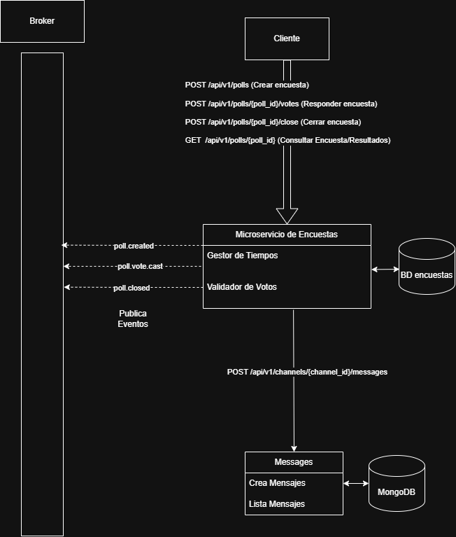
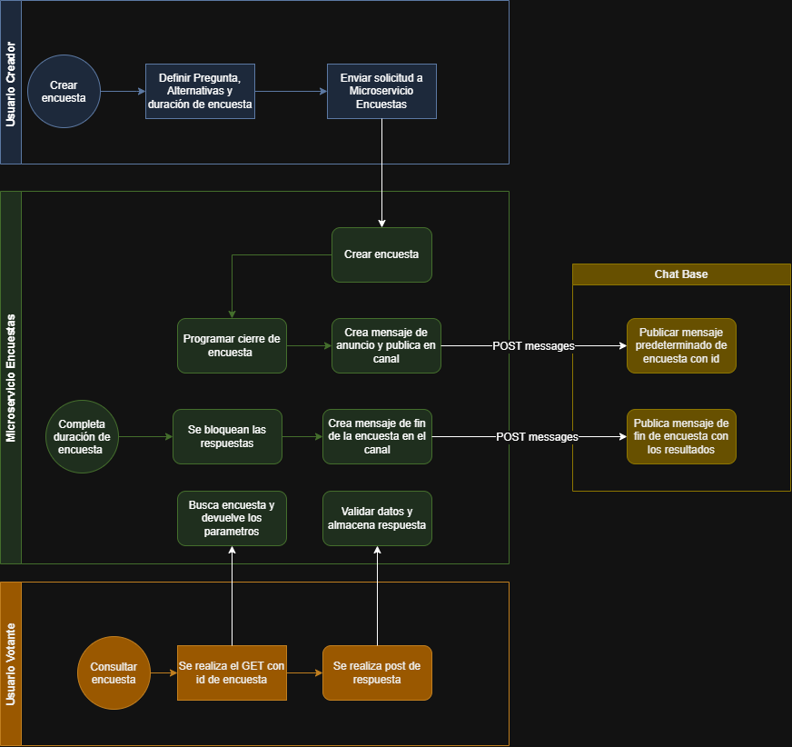

# Diagramas del sistema

Estos diagramas complementan la [referencia de la API REST](api.md) y muestran los componentes principales del servicio y sus flujos.

## Arquitectura

El cliente interactúa con el microservicio de Encuestas mediante la API REST para crear, consultar, responder y cerrar encuestas. Polls conserva los datos en su base de datos y publica eventos de creación, voto y cierre en el broker. Además, se comunica con Messages mediante `POST /api/v1/channels/{channel_id}/messages` para publicar anuncios y resultados; Messages almacena sus mensajes en MongoDB.

## Flujo de una encuesta

El usuario creador envía la pregunta, las alternativas y la duración. Polls crea la encuesta, programa su cierre y solicita a Messages publicar el anuncio en el canal. Al completarse la duración, Polls bloquea las respuestas y solicita la publicación de los resultados finales. Un usuario votante puede consultar la encuesta y enviar su voto; Polls busca la encuesta, valida los datos y almacena la respuesta.
